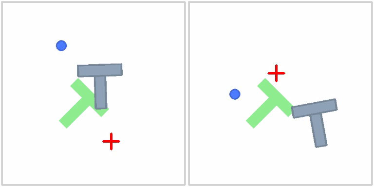
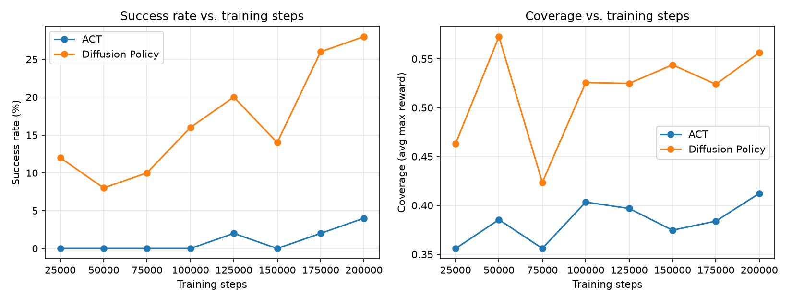

# PushT Imitation Learning: ACT vs Diffusion Policy

A hands-on project comparing two imitation-learning policies — **ACT** (Action Chunking
Transformer) and **Diffusion Policy** — on the PushT robot-manipulation task, built on
HuggingFace [LeRobot](https://github.com/huggingface/lerobot).

Trained and evaluated entirely in simulation (no robot hardware required), on a single
NVIDIA RTX 3080 (16 GB) laptop GPU.

## Demo

Side-by-side rollout at 200k training steps — **left: Diffusion Policy (succeeds)**,
**right: ACT (fails to reach the target)**:



## Results

Both policies were trained from scratch for **200,000 steps** (batch size 64) on the
`lerobot/pusht` dataset and evaluated on 50 rollouts.

| Policy               | Success rate | Coverage | Params | Checkpoint size |
|----------------------|-------------:|---------:|-------:|----------------:|
| ACT                  |          4 % |    0.412 |   52 M |         ~0.6 GB |
| **Diffusion Policy** |      **28 %** | **0.556** | 263 M |           ~3 GB |



**Key findings**

- **Diffusion Policy clearly wins**: 28 % vs 4 % success (7× gap), and higher coverage
  (0.556 vs 0.412).
- **Diffusion Policy learns faster**: it already reaches 12 % success at 25k steps, while
  ACT stays at 0 % until 125k steps and never really takes off.
- **ACT is far more parameter-efficient** (52 M vs 263 M params) but underperforms on this
  task at equal training budget, consistent with the original papers' trends on PushT.

## What this project does

- Trains **ACT** and **Diffusion Policy** from scratch on the `lerobot/pusht` dataset
  (206 human-teleoperated episodes).
- Evaluates both policies in the `gym_pusht/PushT-v0` simulation environment.
- Compares them on success rate and coverage vs. training steps, with side-by-side
  rollout videos.

## Setup (Windows 11, native)

Tested on Windows 11 with an NVIDIA RTX 3080 (16 GB), CUDA 12.6, Python 3.11.

```bash
# 1. create env
conda create -n lerobot python=3.11 -y
conda activate lerobot

# 2. install PyTorch with CUDA (the default PyPI wheel is CPU-only)
pip install torch==2.10.0 torchvision==0.25.0 --index-url https://download.pytorch.org/whl/cu126

# 3. install LeRobot + the pusht environment
pip install lerobot[pusht]
```

> **Note for users in China:** the default conda/pip/HuggingFace sources are often
> unreachable. Use mirrors:
> ```bash
> export HF_ENDPOINT=https://hf-mirror.com
> pip install lerobot[pusht] -i https://pypi.tuna.tsinghua.edu.cn/simple
> ```

## Reproduce

Train ACT:

```bash
lerobot-train \
  --dataset.repo_id=lerobot/pusht \
  --policy.type=act \
  --policy.push_to_hub=False \
  --policy.use_amp=True \
  --env.type=pusht \
  --output_dir=outputs/train/act_pusht \
  --steps=200000 \
  --batch_size=64 \
  --eval_freq=25000 \
  --eval.n_episodes=50 \
  --eval.batch_size=50 \
  --num_workers=0
```

Train Diffusion Policy (same command, with `--policy.type=diffusion`):

```bash
lerobot-train \
  --dataset.repo_id=lerobot/pusht \
  --policy.type=diffusion \
  --policy.push_to_hub=False \
  --policy.use_amp=True \
  --env.type=pusht \
  --output_dir=outputs/train/diffusion_pusht \
  --steps=200000 \
  --batch_size=64 \
  --eval_freq=25000 \
  --eval.n_episodes=50 \
  --eval.batch_size=50 \
  --num_workers=0
```

Regenerate the comparison plot (parses the training logs):

```bash
python scripts/plot_comparison.py
```

## Windows gotchas

Running LeRobot natively on Windows surfaced a few issues worth documenting:

1. **Checkpoint `last` symlink fails** (`WinError 1314`, requires admin/Developer Mode).
   LeRobot creates a `last` symlink to the newest checkpoint; on Windows this needs
   elevated privileges. Workaround: patch `update_last_checkpoint` in
   `lerobot/utils/train_utils.py` to fall back to a directory junction (`mklink /J`),
   which needs no special privilege.

2. **DataLoader workers exit unexpectedly** with `--num_workers=4`. Windows spawns worker
   processes differently than Linux; this intermittently crashes training. Use
   `--num_workers=0`.

3. **`conda run` "batch file cannot be found"** when launching the train script. Prefer
   invoking the interpreter directly:
   ```bash
   D:/Miniconda3/envs/lerobot/python.exe -m lerobot.scripts.lerobot_train ...
   ```

4. **Resume after a crash** works via the `last` checkpoint link (or by pointing at the
   newest `checkpoints/<step>` directory).

## Project structure

```
.
├── assets/              # demo gif + comparison plot (committed)
├── scripts/             # analysis & plotting
│   └── plot_comparison.py
├── outputs/             # training runs (gitignored, large)
├── *.log                # training logs (gitignored)
├── .gitignore
└── README.md
```

## References

- [LeRobot](https://github.com/huggingface/lerobot) — HuggingFace
- [ACT: Learning Fine-Grained Bimanual Manipulation with Low-Cost Hardware](https://arxiv.org/abs/2304.13705)
- [Diffusion Policy: Visuomotor Policy Learning via Action Diffusion](https://arxiv.org/abs/2303.04137)
